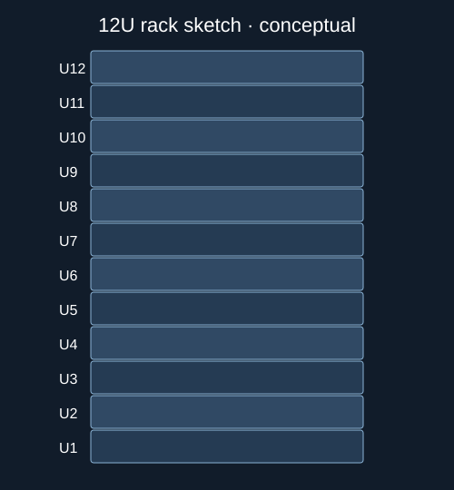

# Rack layout sketches

I wanted a quick way to see whether a rack plan accidentally puts two pieces of equipment in the same U space.

The included **12U layout is fictional** and useful for checking how rack-unit numbering and cable schedules fit together. It's not a record from a real data center.



## Check the example plan
```bash
python3 scripts/validate_rack.py rack_plan.csv
```

Edit `rack_plan.csv` to try different equipment placements. `cable_schedule.csv` is a basic cross-connect sketch.

Don't treat a rack diagram as mounting or electrical authorization. Actual installations require site procedures, load limits, and electrical safety controls.

## Reference images
[Server racks on Wikimedia Commons](https://commons.wikimedia.org/wiki/Special:MediaSearch?type=image&search=server%20rack)
